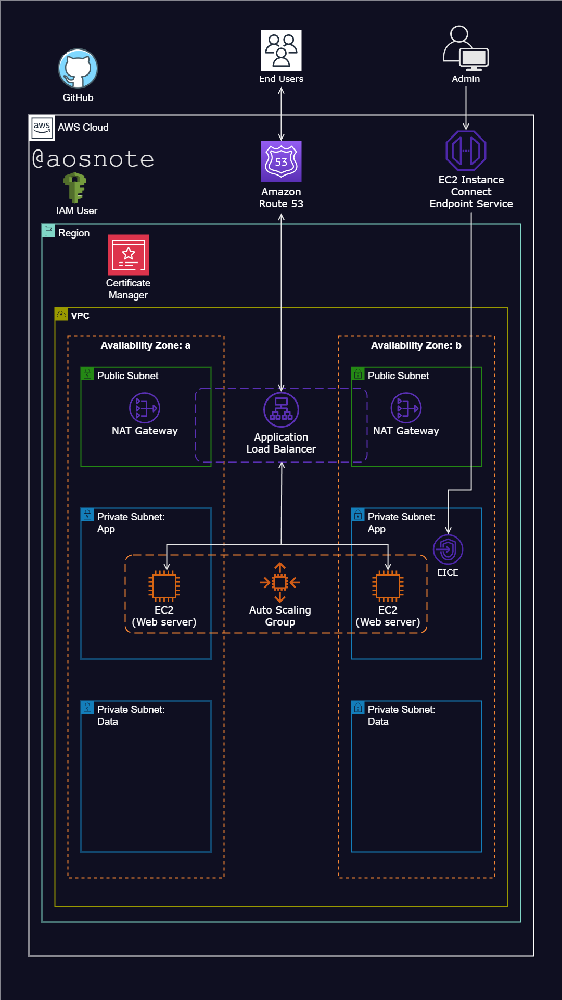

# Host a Static Website on AWS

## Overview

This project demonstrates how to deploy and host a static HTML website on Amazon Web Services (AWS). It explores cloud networking, web server configuration, high availability, load balancing, security, and automated instance management.

The documented architecture uses Amazon EC2 instances running Apache HTTP Server behind an Application Load Balancer (ALB), with an Auto Scaling Group to manage application capacity. Additional AWS services support networking, DNS, HTTPS, and notifications.

## Architecture Diagram



The architecture diagram illustrates the intended AWS infrastructure. Actual availability, security, and scaling behavior depend on the deployed configuration and testing.

## AWS Services and Components

| Service or Component | Purpose |
|---|---|
| Amazon VPC | Provides an isolated network for project resources |
| Public and private subnets | Organize resources across Availability Zones |
| Internet Gateway | Enables internet connectivity for public resources |
| Security Groups | Control inbound and outbound network traffic |
| NAT Gateway | Provides outbound internet access for private-subnet resources |
| Amazon EC2 | Hosts the website using Apache HTTP Server |
| Application Load Balancer | Distributes HTTP/HTTPS traffic across registered instances |
| Auto Scaling Group | Maintains and adjusts the number of EC2 instances |
| EC2 Instance Connect Endpoint | Provides a private connection path for supported EC2 management workflows |
| AWS Certificate Manager | Provides SSL/TLS certificates for supported integrations |
| Amazon Route 53 | Manages DNS records and domain routing |
| Amazon SNS | Sends notifications for configured events |

## Architecture and Security

The intended design uses multiple Availability Zones to support resilience.

- **Load balancer:** Accepts the intended HTTP/HTTPS traffic from website visitors.
- **Application instances:** Receive application traffic from the load balancer.
- **Network access:** Use security groups to restrict traffic to the minimum required.
- **Administration:** Use an approved management path, such as AWS Systems Manager or EC2 Instance Connect where appropriate.
- **HTTPS:** Configure a valid certificate and an HTTPS listener on the load balancer.
- **Scaling:** Configure Auto Scaling policies and health checks based on the application's requirements.

Avoid exposing SSH or other administrative ports to the public internet. An Application Load Balancer does not need SSH access for normal operation; management access should be configured separately.

## Prerequisites

Before deploying this project, prepare:

- An AWS account with appropriate permissions.
- An AWS CLI installation if you plan to manage resources through the CLI.
- Basic knowledge of EC2, VPCs, subnets, security groups, and load balancers.
- A domain name if you want to use a custom domain.
- An appropriate SSL/TLS certificate if you plan to enable HTTPS.
- The website source files available in this GitHub repository.

## Deployment Script

The following example installs Apache HTTP Server, retrieves the website files from this repository, and configures Apache to start automatically.

**Example environment:** Amazon Linux 2. Review and adapt the commands if you use another operating system or AMI.

```bash
#!/bin/bash
set -euo pipefail

# Update packages and install required software.
yum update -y
yum install -y httpd git

# Prepare the Apache document root.
mkdir -p /var/www/html
find /var/www/html -mindepth 1 -maxdepth 1 \
  -exec rm -rf -- {} +

# Download the repository into a temporary directory.
REPO_DIR="$(mktemp -d)"
trap 'rm -rf "$REPO_DIR"' EXIT

git clone --depth 1 \
  https://github.com/sunny-ekwugha/Project1-Static-Website.git \
  "$REPO_DIR/source"

# Copy tracked repository files without the Git metadata.
git -C "$REPO_DIR/source" archive HEAD \
  | tar -x -C /var/www/html

# Configure and start Apache.
systemctl enable httpd
systemctl restart httpd
```

This example assumes the repository contains the website's entry page, such as `index.html`, at its root. Verify the repository structure before using it.

The script is illustrative rather than a complete production deployment. For production use, consider pinning a reviewed commit, validating downloaded artifacts, handling errors and logs, and automating deployment through a controlled pipeline.

## Deployment Steps

1. **Prepare the network:** Create the VPC, subnets, route tables, and required gateways.
2. **Configure security:** Create security groups that permit only the required traffic.
3. **Launch EC2 instances:** Select a supported AMI and install Apache using the deployment script.
4. **Configure the target group:** Register the instances and define an appropriate health-check path.
5. **Create the load balancer:** Configure listeners and attach the target group.
6. **Configure Auto Scaling:** Set up the launch template, desired capacity, scaling policies, and Availability Zones.
7. **Enable HTTPS:** Configure a certificate and an HTTPS listener.
8. **Configure DNS:** Point the domain to the load balancer using the appropriate Route 53 record.
9. **Test the deployment:** Confirm the website loads, health checks pass, and the intended network restrictions work.

These steps describe the general workflow. Resource-specific settings depend on your AWS account, region, AMI, and chosen architecture.

## Project Structure

The repository contains the website source files and the architecture diagram used to document the project.

The deployed website files are served from:

```text
/var/www/html/
```

The Apache document root may differ if you change the web server configuration.

## Accessing the Website

After deployment, open the DNS name of the Application Load Balancer in a browser. If you configure a custom domain, use that domain after verifying its DNS records and HTTPS certificate.

For an HTTPS deployment, use the HTTPS URL.

## Cost and Cleanup

AWS resources may incur charges while they exist, including EC2 instances, NAT Gateways, load balancers, Elastic IP addresses, and related storage or data transfer.

When the project is no longer needed:

1. Remove the Auto Scaling Group and associated launch resources.
2. Delete the Application Load Balancer and target group.
3. Terminate project EC2 instances.
4. Remove unused NAT Gateways and other billable networking resources.
5. Review and remove unneeded Route 53 records and other project-specific resources.
6. Verify that no unwanted resources, snapshots, or other billable items remain.

Check resource dependencies and confirm that you no longer need any data before deleting resources.

## Key Learnings

This project provides practical learning opportunities in:

- AWS networking and subnet design.
- Apache web server deployment.
- Application Load Balancing.
- Auto Scaling and multi-AZ architecture.
- DNS and HTTPS configuration.
- Security groups and controlled administrative access.
- Automating server setup with Bash.

## License

If you intend to distribute this project, add a `LICENSE` file and document the applicable license.
